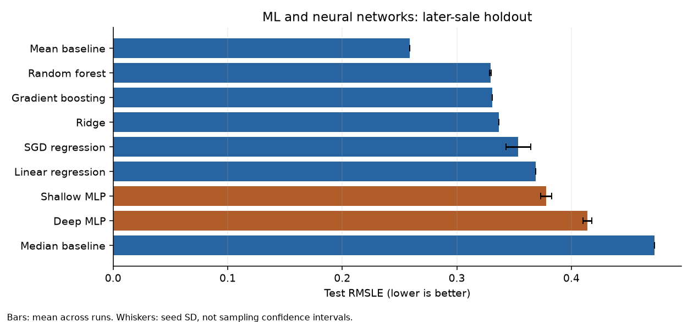
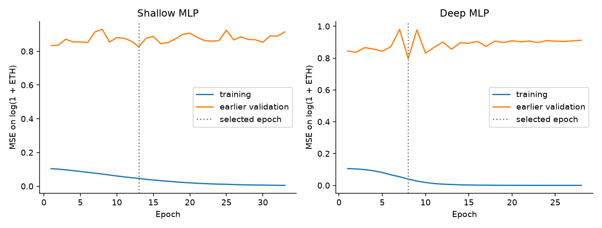

# MISY331: NFT Price Prediction | NFT 价格预测

<p align="center">
  
  &nbsp;
  
</p>

<p align="center">
  
  &nbsp;
  
  &nbsp;
  
</p>

[English](#english) | [中文](#中文)

---

## English

### Project overview

A reproducible extension of MISY331 Assignment 5 comparing basic machine learning and PyTorch neural networks on Crypto Coven NFT sale amounts.

**Result:** none of the learned models beat the mean baseline fitted on training plus validation on the later-sale test window. Random forest performs best among learned models; the two-hidden-layer MLP performs worse than the one-hidden-layer MLP. These are results from one historical snapshot and one chronological holdout.

[Executed notebook](notebooks/01_model_comparison.ipynb) · [HTML report](notebooks/01_model_comparison.html) · [Experiment record](results/experiment.json) · [Data provenance](data/README.md)



The original assignment used a random split. This extension uses chronological training, validation, and test windows, retains 32 NFT traits, and excludes owner identity and cumulative sale counts. The repository preserves actual results, candidate parameters, random seeds, and learning curves. These are subsequent coursework experiments, not methods already included in the original submission, return forecasts, or a trading backtest.

---

### Question and data

Can static NFT attributes predict a later group of sale amounts, and does a small neural network improve on simpler estimators?

The dataset is Harry Wang's [Crypto Coven dataset](https://www.kaggle.com/datasets/harrywang/crypto-coven), collected on **2022-04-21**. The author's [public mirror](https://huggingface.co/datasets/harrywang/crypto-coven) declares the MIT license. The included data contain 9,764 rows and 35 columns, stripped to traits, token ID, sale amount, and sale time. After dropping 4,868 rows without a sale amount and deduplicating one priced token, 4,895 unique sold NFTs remain.

The response is `last_sale.total_price / 10**18`, in ETH-equivalent units. The expanded source export was checked: priced sales use ETH or WETH with 18 decimals. We avoid snapshot-dependent USD conversions. Only the 6 numeric and 26 categorical traits in `src/data.py` are predictors; token ID is used for deduplication and timestamp only for the split.

| Window (UTC) | Rows | Date range | Mean ETH | Median ETH |
|---|---:|---|---:|---:|
| train | 2,901 | 2021-11-07 to 2022-01-22 | 0.582 | 0.279 |
| validation | 998 | 2022-01-23 to 2022-02-09 | 2.740 | 2.500 |
| test | 996 | 2022-02-10 to 2022-04-21 | 1.400 | 1.200 |

Split boundaries approximate 60/20/20 by sorted records and keep each UTC calendar day together. These irregular observations have different window lengths. Each NFT appears once. This is a latest-sale snapshot, so chronological separation **does not eliminate snapshot selection bias** or recreate a transaction-by-transaction investment setting.

---

### Models and evaluation

| Method | Basic idea | Small validation search |
|---|---|---|
| Mean / median | Constant prediction from fitting-window raw ETH prices | No tuning |
| Linear regression | Ordinary least squares on log sale amount | No tuning |
| Ridge | L2-regularized linear regression | alpha: 0.1, 1, 10, 100 |
| SGD regression | L2 linear regression fitted by stochastic gradients | alpha: 0.0001, 0.001 |
| Random forest | Averaged regression trees | (depth, leaf): (8, 2), (16, 2), (unlimited, 5) |
| Gradient boosting | Histogram-based boosted trees | (leaves, L2): (7, 1), (15, 1), (15, 10) |
| Shallow MLP | One hidden layer with ReLU | 32 units/no dropout; 64 units/0.1 dropout |
| Deep MLP | Two hidden layers with ReLU | 64 -> 32 units; dropout 0 or 0.1 |

1. Fit numeric median imputation and standardization on the fitting window. Fill missing categories with an explicit absence label, one-hot encode, pool categories occurring fewer than five times, and ignore unseen categories. Some missing traits may be unknown rather than absent; the dataset does not distinguish them reliably.
2. Fit learned estimators on `log1p(price_eth)` with squared error. Neural targets are additionally standardized using fitting-window statistics. Invert using `expm1` and floor negative predictions at zero. Inverting a log-space prediction does not produce an unbiased estimate of the raw-price conditional mean.
3. Choose candidates using **earlier validation RMSLE**, with selection seed 42. MLPs use Adam (learning rate 0.001, weight decay 0.0001), batch size 128, at most 200 epochs and patience 20. Their epoch is selected by validation log MSE before the candidate is compared by clipped RMSLE. Forests use 160 trees; boosting uses 160 iterations at learning rate 0.05. Search budgets are small and differ by model; this is a practical baseline comparison rather than exhaustive tuning.
4. Refit each selected configuration on training plus validation. Freeze the MLP epoch count before final fitting. Report the later test window without using it for candidate selection or early stopping. Constant baselines use the same combined fitting window in raw ETH units.
5. Run stochastic estimators with seeds **42, 7, 2026**; deterministic estimators and baselines run once. Report RMSLE, ETH RMSE, ETH MAE, and R2. Seed spread measures optimization variability, **not** sampling uncertainty or a confidence interval. Boosting has identical outcomes across these seeds under these settings.

---

### Held-out results

| Model | Runs | RMSLE | RMSE (ETH) | MAE (ETH) | R2 |
|---|---:|---:|---:|---:|---:|
| Mean baseline | 1 | 0.2590 | 0.7651 | 0.4520 | -0.137 |
| Random forest | 3 | 0.3293 | 0.8948 | 0.5891 | -0.556 |
| Gradient boosting | 3 | 0.3311 | 0.8955 | 0.5854 | -0.558 |
| Ridge | 1 | 0.3368 | 0.9004 | 0.5969 | -0.575 |
| SGD regression | 3 | 0.3537 | 0.9185 | 0.6242 | -0.640 |
| Linear regression | 1 | 0.3688 | 0.9345 | 0.6480 | -0.697 |
| Shallow MLP | 3 | 0.3781 | 0.9461 | 0.6640 | -0.739 |
| Deep MLP | 3 | 0.4140 | 0.9992 | 0.7191 | -0.940 |
| Median baseline | 1 | 0.4725 | 1.1126 | 0.8527 | -1.405 |

Exact per-run results are in [test_metrics.csv](results/test_metrics.csv), candidate results in [validation_candidates.csv](results/validation_candidates.csv), and training histories in [learning_curves.csv](results/learning_curves.csv). All learned models also have negative test R2. R2 compares with the observed test-window mean (an evaluation reference unavailable to a deployed model), whereas the reported mean baseline is estimated only from earlier fitting data.



The training-window median is 0.279 ETH; the validation median is 2.500 ETH and the test median is 1.200 ETH. This observed price distribution shift makes static-trait extrapolation difficult. The MLP curves show a growing training/validation gap, consistent with weak generalization. They cannot separate memorization from temporal distribution shift. On the validation window, the training-only mean baseline also achieves RMSLE 0.8615, better than the best learned candidate, Deep MLP at 0.8921. The notebook computes that comparison directly.

The deeper MLP being best among learned validation candidates and worse on the later test window shows why architecture choice alone is insufficient. No claim of profitable signals, causal trait effects, universal tree-model superiority, or measured financial signal-to-noise follows from this experiment. Testing multiple temporal windows and collecting genuine transaction history would be sensible subsequent research; they are outside this baseline project.

---

### Reproduce

Use **Python 3.12** on a 64-bit Windows or Linux machine. The saved run used Python 3.12.14 and CPU PyTorch; exact package versions are pinned in `requirements.txt` and recorded in `results/experiment.json`.

```bash
python -m venv .venv
# Windows PowerShell:
.venv\Scripts\Activate.ps1
# Linux instead: source .venv/bin/activate
python -m pip install -r requirements.txt
python -m src.train
python -m pytest -q --basetemp .test-tmp-local
```

The data needed for the default command are included. The dependency file uses PyTorch's CPU wheel index; these pins target the tested Windows/Linux CPU environment. Package availability and numerical precision may differ on other platforms.

Open `notebooks/01_model_comparison.ipynb` in Jupyter or VS Code. The notebook loads the saved experiment results by default and executes the data audit and interpretation; set `RUN_TRAINING = True` to regenerate all results. The checked-in notebook includes executed outputs and an HTML export. The Python module is the single training implementation; the notebook does not duplicate it.

To fetch the unmodified, pinned public source instead:

```bash
python download_data.py
python -m src.train --data data/witches.csv
```

---

### Repository contents

```text
data/          Curated traits, attribution, source revision
src/           Data preparation, model definitions, training, figures
notebooks/     Executed report notebook and HTML export
results/       Aggregate metrics, chosen parameters, learning curves, figures
tests/         Units/deduplication, temporal split, preprocessing isolation,
               metric units, seeded neural fitting
```

The original assignment materials, raw owner fields, local environment and token-level prediction export are excluded. Code is licensed under MIT; dataset attribution and its author's license declaration are documented separately in `data/README.md`.

---

## 中文

### 项目简介

这是 MISY331 第 5 次作业的可复现实验扩展，比较基础机器学习模型与 PyTorch 神经网络对 Crypto Coven NFT 成交金额的预测表现。

**结果：** 在较晚成交的测试窗口中，所有学习模型均未超过基于训练集与验证集合并数据拟合的均值基准。随机森林在学习模型中表现最好；两层隐藏层 MLP 的表现弱于一层隐藏层 MLP。这些结果来自一个历史快照和一次按时间划分的留出评估。

[已执行的 notebook](notebooks/01_model_comparison.ipynb) · [HTML 报告](notebooks/01_model_comparison.html) · [实验记录](results/experiment.json) · [数据来源](data/README.md)


原作业使用随机划分。本次扩展按时间划分训练、验证和测试窗口，保留 32 个 NFT 属性，排除持有人身份和累计成交次数。仓库保留实际结果、候选参数、随机种子和学习曲线。这些是课程作业的后续实验，不代表原提交已经包含这些方法，也不构成收益预测或交易回测。

---

### 研究问题与数据

静态 NFT 属性能否预测较晚一批成交的金额？小型神经网络能否优于更简单的估计方法？

数据来自 Harry Wang 的 [Crypto Coven 数据集](https://www.kaggle.com/datasets/harrywang/crypto-coven)，采集于 **2022-04-21**。作者的[公开镜像](https://huggingface.co/datasets/harrywang/crypto-coven)声明采用 MIT 许可证。仓库内的数据包含 9,764 行、35 列，仅保留属性、token ID、成交金额和成交时间。剔除 4,868 行缺少成交金额的记录，并对一个有成交价格的重复 token 去重后，剩余 4,895 个已成交的唯一 NFT。

目标变量为 `last_sale.total_price / 10**18`，单位是 ETH 等值。已核实展开后的原始导出数据：有成交价格的记录使用 ETH 或 WETH，精度均为 18 位。项目避免使用依赖快照时点的美元换算。只有 `src/data.py` 中的 6 个数值属性和 26 个类别属性作为预测变量；token ID 用于去重，时间戳仅用于划分数据。

| 窗口（UTC） | 行数 | 日期范围 | 均值（ETH） | 中位数（ETH） |
|---|---:|---|---:|---:|
| 训练 | 2,901 | 2021-11-07 至 2022-01-22 | 0.582 | 0.279 |
| 验证 | 998 | 2022-01-23 至 2022-02-09 | 2.740 | 2.500 |
| 测试 | 996 | 2022-02-10 至 2022-04-21 | 1.400 | 1.200 |

按排序后的记录近似划分为 60/20/20，并将同一个 UTC 日历日的记录保留在同一窗口内。这些观测的时间间隔不规则，各窗口的时间长度不同。每个 NFT 只出现一次。数据是最近一次成交的快照，因此按时间分离**不能消除快照选择偏差**，也不能还原逐笔交易的投资场景。

---

### 模型与评估

| 方法 | 基本思路 | 小范围验证集搜索 |
|---|---|---|
| 均值 / 中位数 | 根据拟合窗口内的原始 ETH 成交价格作常数预测 | 不调参 |
| 线性回归 | 对数成交金额的普通最小二乘回归 | 不调参 |
| Ridge | L2 正则化线性回归 | alpha：0.1、1、10、100 |
| SGD 回归 | 使用随机梯度拟合的 L2 线性回归 | alpha：0.0001、0.001 |
| 随机森林 | 对多棵回归树的预测取平均 | （深度，叶节点最小样本数）：(8, 2)、(16, 2)、(不限, 5) |
| 梯度提升 | 基于直方图的提升树 | （叶节点数，L2）：(7, 1)、(15, 1)、(15, 10) |
| 浅层 MLP | 一层隐藏层，使用 ReLU | 32 个单元 / 无 dropout；64 个单元 / dropout 为 0.1 |
| 深层 MLP | 两层隐藏层，使用 ReLU | 64 -> 32 个单元；dropout 为 0 或 0.1 |

1. 仅在拟合窗口内学习数值变量的中位数填补与标准化参数。用明确的属性不存在标签填补类别变量，进行独热编码，合并出现少于五次的类别，并忽略未见过的类别。一些缺失属性可能表示未知，而非不存在；数据集无法可靠地区分两者。
2. 学习模型以 `log1p(price_eth)` 为目标，最小化平方误差。神经网络还使用拟合窗口内的统计量对目标进行标准化。通过 `expm1` 还原预测，并将负预测值截断为零。将对数空间的预测还原，并不能得到原始价格条件均值的无偏估计。
3. 使用**较早验证窗口的 RMSLE** 选择候选配置，选择阶段的随机种子为 42。MLP 使用 Adam（学习率 0.001，权重衰减 0.0001），批量大小为 128，最多训练 200 个 epoch，早停耐心值为 20。先根据验证集上的对数目标 MSE 选择 epoch，再使用截断预测后的 RMSLE 比较候选配置。随机森林使用 160 棵树；梯度提升使用 160 次迭代，学习率为 0.05。搜索范围较小，且各模型的搜索预算不同；这是实用的基准比较，并非穷尽式调参。
4. 使用训练集与验证集的合并数据重新拟合选定配置。在最终拟合前固定 MLP 的 epoch 数。较晚的测试窗口仅用于报告结果，不参与候选配置选择或早停。常数基准使用相同的合并拟合窗口，直接基于原始 ETH 价格计算。
5. 对随机估计方法使用种子 **42、7、2026**；确定性估计方法和基准只运行一次。报告 RMSLE、以 ETH 为单位的 RMSE 和 MAE，以及 R2。种子间差异反映优化过程的变动，**不代表**抽样不确定性或置信区间。在当前设置下，梯度提升在这些种子下得到相同结果。

---

### 留出测试结果

| 模型 | 运行次数 | RMSLE | RMSE（ETH） | MAE（ETH） | R2 |
|---|---:|---:|---:|---:|---:|
| 均值基准 | 1 | 0.2590 | 0.7651 | 0.4520 | -0.137 |
| 随机森林 | 3 | 0.3293 | 0.8948 | 0.5891 | -0.556 |
| 梯度提升 | 3 | 0.3311 | 0.8955 | 0.5854 | -0.558 |
| Ridge | 1 | 0.3368 | 0.9004 | 0.5969 | -0.575 |
| SGD 回归 | 3 | 0.3537 | 0.9185 | 0.6242 | -0.640 |
| 线性回归 | 1 | 0.3688 | 0.9345 | 0.6480 | -0.697 |
| 浅层 MLP | 3 | 0.3781 | 0.9461 | 0.6640 | -0.739 |
| 深层 MLP | 3 | 0.4140 | 0.9992 | 0.7191 | -0.940 |
| 中位数基准 | 1 | 0.4725 | 1.1126 | 0.8527 | -1.405 |

每次运行的精确结果见 [test_metrics.csv](results/test_metrics.csv)，候选配置的结果见 [validation_candidates.csv](results/validation_candidates.csv)，训练过程记录见 [learning_curves.csv](results/learning_curves.csv)。所有学习模型的测试 R2 也均为负值。R2 以观测到的测试窗口均值为比较参照，该参照在模型部署时不可获得；报告中的均值基准则仅使用较早的拟合数据估计。


训练窗口的中位成交价为 0.279 ETH，验证窗口为 2.500 ETH，测试窗口为 1.200 ETH。这种观测到的价格分布变化使静态属性的外推变得困难。MLP 曲线显示训练与验证误差之间的差距逐渐扩大，与泛化表现较弱相符，但无法区分记忆训练样本与时间分布变化的影响。在验证窗口中，仅根据训练数据计算的均值基准也取得了 0.8615 的 RMSLE，优于表现最好的学习模型候选，即 RMSLE 为 0.8921 的深层 MLP。Notebook 直接计算了这一比较。

较深的 MLP 在学习模型的验证候选中表现最好，却在较晚的测试窗口表现更差，说明仅靠选择网络结构并不足够。这项实验不能支持关于盈利信号、属性因果效应、树模型普遍优越性或已测得金融信噪比的结论。在多个时间窗口中测试，并采集完整交易历史，是合理的后续研究方向；它们不属于本次基础项目的范围。

---

### 复现方法

使用 64 位 Windows 或 Linux 环境中的 **Python 3.12**。保存的实验使用 Python 3.12.14 与 CPU 版 PyTorch；精确依赖版本已固定在 `requirements.txt` 中，并记录在 `results/experiment.json` 中。

```bash
python -m venv .venv
# Windows PowerShell：
.venv\Scripts\Activate.ps1
# Linux 则使用：source .venv/bin/activate
python -m pip install -r requirements.txt
python -m src.train
python -m pytest -q --basetemp .test-tmp-local
```

默认命令所需的数据已包含在仓库内。依赖文件使用 PyTorch 的 CPU wheel 索引；这些版本针对已经测试的 Windows/Linux CPU 环境。其他平台的软件包可用性与数值精度可能不同。

在 Jupyter 或 VS Code 中打开 `notebooks/01_model_comparison.ipynb`。Notebook 默认读取保存的实验结果，并执行数据核查与结果解读；将 `RUN_TRAINING = True` 可重新生成全部结果。仓库中的 notebook 包含已执行的输出和 HTML 导出。Python 模块是唯一的训练实现，notebook 不重复实现训练代码。

如需改用未经修改、固定版本的公开原始数据：

```bash
python download_data.py
python -m src.train --data data/witches.csv
```

---

### 仓库内容

```text
data/          筛选后的属性数据、来源署名与源数据版本
src/           数据准备、模型定义、训练与绘图
notebooks/     已执行的报告 notebook 与 HTML 导出
results/       汇总指标、选定参数、学习曲线与图表
tests/         单位与去重、时间划分、预处理隔离、
               指标单位与固定种子的神经网络拟合
```

仓库不包含原始作业材料、原始持有人字段、本地环境和逐 token 的预测导出。代码采用 MIT 许可证；数据集署名及其作者的许可证声明单独记录在 `data/README.md` 中。
